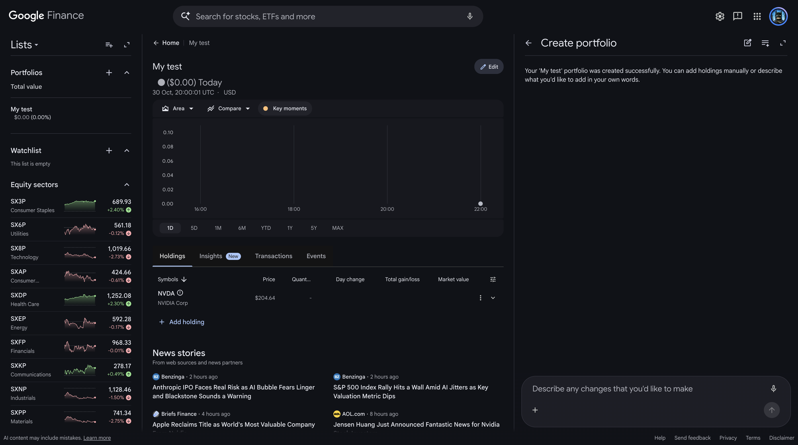
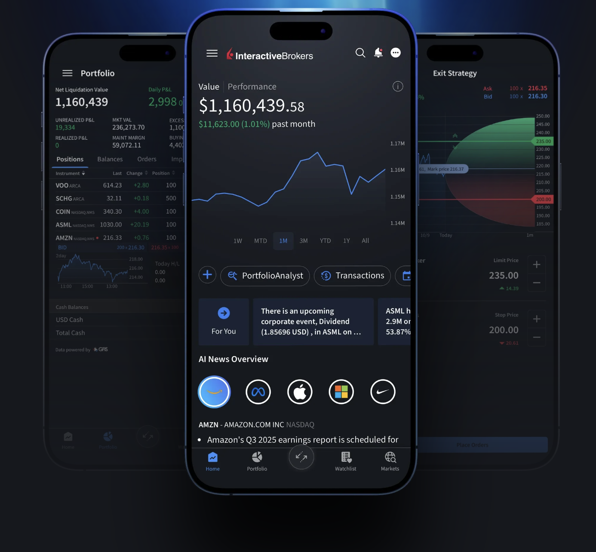
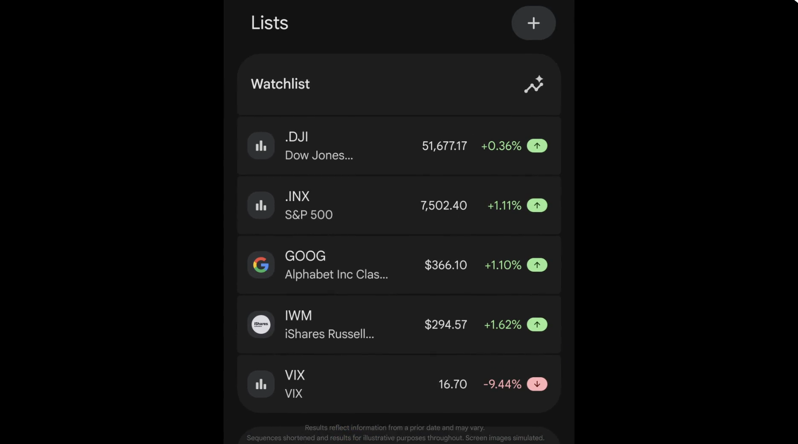
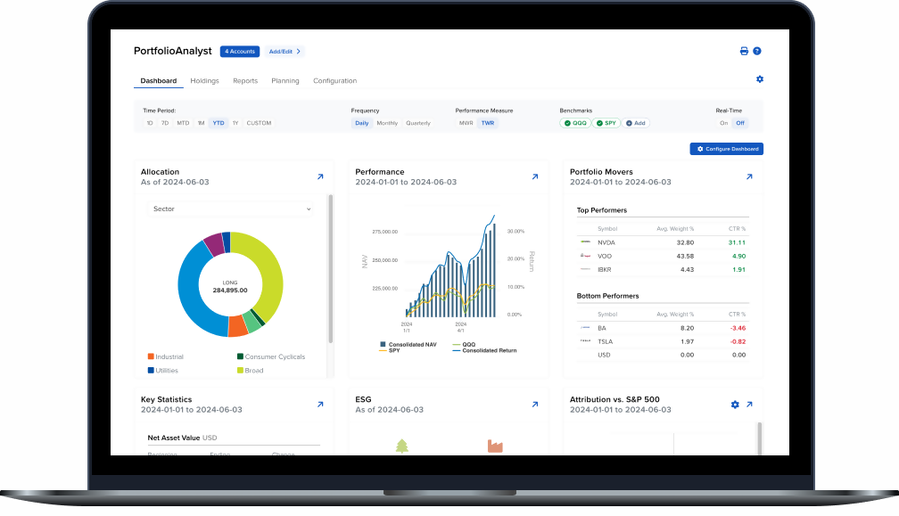

# Lab 1: Define the Initial Product

## 1. Product research

### Research question

> How do existing products help a User follow market information, and which
> parts belong in this Dashboard's first version?

| Product | Likely User and goal | Reusable pattern |
| ------- | -------------------- | ---------------- |
| Google Finance (market data) | Someone who invests on their own and checks the market often. They want to see prices and how their own stocks are doing. | The User adds their stocks to a portfolio. For each stock it shows the price, how many they own, the change today, total gain or loss and what it's worth now, plus the time of the price. There are also watchlists. |
| Interactive Brokers (trading) | An IBKR client who wants to keep an eye on what's in their account, and buy or sell it. | A list of what the User owns, with what it's worth now, profit or loss today, and profit or loss on things not sold yet. All accounts are on one page, and each block shows the date of its data. |

Sources: [Google Finance](https://www.google.com/finance/), [IBKR Mobile](https://www.interactivebrokers.com/en/trading/ibkr-mobile.php), [PortfolioAnalyst](https://www.interactivebrokers.com/en/portfolioanalyst/overview.php)

Scope decision: the research confirmed that the Dashboard only follows investments and does not trade.

  
  
  
  

## 2. Stakeholders and actors

## 3. Product promise and scope

## 4. Functional requirements

## 5. C4 System Context view
