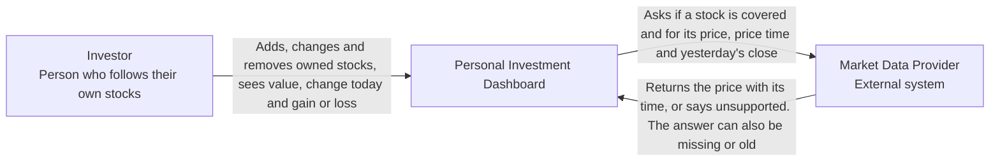

# Lab 1: Define the Initial Product

Student: Nicolai Gorpinevici
 
Group: INFA241fr

Product: Personal Investment Dashboard

Client request: "Help me follow my investments."

## 1. Product research

### Research question

> How do existing products help a User follow market information, and which
> parts belong in this Dashboard's first version?

### What I found

| Product | Likely User and goal | Reusable pattern |
| ------- | -------------------- | ---------------- |
| Google Finance (market data) | Someone who invests on their own and checks the market often. They want to see prices and how their own stocks are doing. | The User adds their stocks to a portfolio. For each stock it shows the price, how many they own, the change today, total gain or loss and what it's worth now, plus the time of the price. There are also watchlists. |
| Interactive Brokers (trading) | An IBKR client who wants to keep an eye on what's in their account, and buy or sell it. | A list of what the User owns, with what it's worth now, profit or loss today, and profit or loss on things not sold yet. All accounts are on one page, and each block shows the date of its data ("As of"). |

### Evidence

**Pattern A (Google Finance).** The User adds their own stocks to a portfolio. Each stock shows price, quantity, change today, total gain or loss, value now and the time of the price.

Sources: [Google Finance](https://www.google.com/finance/), [Google Finance help, portfolios](https://support.google.com/websearch/answer/16490185?hl=en#manage_portfolios), [Google Finance blog, June 2026](https://blog.google/products-and-platforms/products/search/google-finance-updates-june-2026/)

**Pattern B (Interactive Brokers).** One list of what the User owns, with value now, profit or loss today and profit or loss on things not sold yet.

Source: [IBKR Mobile](https://www.interactivebrokers.com/en/trading/ibkr-mobile.php)

**Pattern C (Interactive Brokers).** Each block shows the date of its data ("As of").

Source: [IBKR PortfolioAnalyst](https://www.interactivebrokers.com/en/portfolioanalyst/overview.php)

### What goes into the first version

| Pattern | Decision | Why |
| ------- | -------- | --- |
| List of my own stocks with quantity and buy price (A) | First version | Every other number is worked out from it. |
| Value now, change today, gain or loss, per stock and in total (A, B) | First version | This is what "follow my investments" means: am I up or down. |
| Time of each price (A, C) | First version | A number without a time can be old and still look current. |
| Buying and selling (Interactive Brokers) | Deferred | The client asked to follow investments, not to trade. |
| All accounts from a broker on one page (Interactive Brokers) | Deferred | It needs a connection to each broker. In the first version the User types in what they own. |
| Watchlists of stocks the User does not own (Google Finance) | Deferred | They are not "my investments", so they can wait. |

### Scope decision

The research confirmed that the Dashboard only follows investments and does
not trade (non-goal N1). It also confirmed that every price must show its
time, because both products show one (goal G4).

## 2. Stakeholders and actors

Method: [UK Government stakeholder-mapping guide](https://analysisfunction.civilservice.gov.uk/policy-store/stakeholder-mapping/).
I listed who is affected by the Dashboard or can change it, marked motivation
and influence as high or low, and gave one reason for each placement.

In this document the Investor is the User.

| Stakeholder | Motivation | Influence | Reason |
| ----------- | ---------- | --------- | ------ |
| Investor | High | Low | It is their money, so they care the most, but one Investor cannot change what goes into the first version. |
| Market Data Provider | Low | High | It does not care about this Dashboard, but without its prices the Dashboard cannot show any value. |
| Product owner | High | High | Turns the client's request into the first version: decides what goes in and accepts the result. |
| Stock exchange | Low | High | It does not care about this Dashboard, but it is where prices come from, and its rules for showing prices reach the Dashboard through the Market Data Provider. |

### Motivation and influence matrix

| Motivation | Low influence | High influence |
| ---------- | ------------- | -------------- |
| High | Investor (consult with) | Product owner (manage closely) |
| Low | (none) | Market Data Provider, Stock exchange (keep satisfied) |

### Actor classification

| Stakeholder | Type | On the C4 view? | Why |
| ----------- | ---- | --------------- | --- |
| Investor | Direct human actor | Yes | Adds their stocks and reads the results. |
| Market Data Provider | External system | Yes | The Dashboard asks it for prices directly. |
| Product owner | Other stakeholder | No | Makes product decisions but does not use the Dashboard to follow investments. |
| Stock exchange | Other stakeholder | No | Its prices reach the Dashboard only through the Market Data Provider, never directly. |

## 3. Product promise and scope

### Product promise

> **Personal Investment Dashboard** helps **a private investor** solve **not
> knowing what their stocks are worth now and how they are doing** so that
> **they can see in one private place the value, today's change and total gain
> or loss of what they own, and how old each price is**.

### Goals

| ID | Goal (what the Investor can see) |
| -- | -------------------------------- |
| G1 | The Investor can add, change and remove the stocks they own, with quantity and buy price, and see them in one list. |
| G2 | The Investor sees the price and value now of each stock and the total value of the portfolio. |
| G3 | The Investor sees the change today and the gain or loss since buying, for each stock and for the whole portfolio. |
| G4 | The Investor sees the time of each price. A missing or old price is clearly marked and never shown as a normal number, and an unsupported stock is clearly marked as unsupported. |
| G5 | The Investor's portfolio is private: other people cannot see it or change it. |

### Non-goals

| ID | Non-goal (not now) | Work it removes |
| -- | ------------------ | --------------- |
| N1 | No buying or selling. | Orders and their states (sent, done, rejected), and the broker as a trading partner. |
| N2 | No automatic import from brokers or banks. The Investor types their stocks in. | The broker as an external system and its failures (no access, late or wrong account data). |
| N3 | No other currencies. The first version only supports stocks priced in one currency. A stock in any other currency is "unsupported". | The money conversion rule and a source of exchange rates. |

## 4. Functional requirements

### DASH-1: Add a stock I own (G1, G4)

Actor goal: The Investor needs to put a stock they own into the Dashboard.

User story: As an Investor, I want to add a stock I own with its quantity and
buy price, so that the Dashboard can follow it for me.

Definitions of done:

- After saving, the stock is in my list with its name, quantity and buy price.
- If the quantity or buy price is empty, zero or below zero, the stock is not
  added and I see which field is wrong.
- If the Market Data Provider does not cover the stock, or the stock is priced
  in another currency, I see "unsupported" and the stock is not added.
- If the Dashboard gets no answer about the stock right now, I see "cannot
  check this stock now, try again later" and the stock is not added.

### DASH-2: Change or remove a stock (G1, G5)

Actor goal: The Investor needs the list to match what they really own after
they buy or sell at their broker, or after a typo.

User story: As an Investor, I want to change the quantity or buy price of a
stock, or remove it, so that my list matches what I really own.

Definitions of done:

- After I change a stock, its value and gain or loss use the new numbers.
- After I remove a stock, it is gone from the list and from all totals.
- Only I can change or remove my stocks. If someone else tries, they see "no
  access" and nothing changes.

### DASH-3: See what my portfolio is worth now (G2, G4)

Actor goal: The Investor needs to learn what each stock and the whole
portfolio is worth now, and how fresh that number is.

User story: As an Investor, I want to see the price and value of each stock
and the total value, so that I know what my investments are worth now.

Definitions of done:

- Each stock shows its price, the time of that price and its value (quantity
  times price). The total is the sum of these values.
- If a price is missing, the stock shows "price unavailable", never 0, and the
  total says it is partial and how many stocks are left out.
- If a price is older than the allowed age (the number is set in Lab 2), the
  stock shows "old price" with its time, and the total says it uses an old
  price.

### DASH-4: See how my stocks are doing (G3, G4)

Actor goal: The Investor needs to learn if they are making or losing money,
today and since buying.

User story: As an Investor, I want to see the change today and the gain or
loss since buying for each stock and for the whole portfolio, so that I know
if I am making or losing money.

Definitions of done:

- Each stock and the total show the change today, as an amount and a percent.
- Each stock and the total show the gain or loss since buying (value now minus
  quantity times buy price), as an amount and a percent.
- If a number cannot be worked out because the price or yesterday's closing
  price is missing, it shows "unavailable", never 0, and the total says which
  stocks are left out.

### DASH-5: Keep my portfolio private (G5)

Actor goal: The Investor needs to be sure that only they can see their stocks
and money.

User story: As an Investor, I want only me to see my portfolio, so that nobody
else learns what I own.

Definitions of done:

- When I open the Dashboard, I see my own stocks and no one else's.
- If another person tries to open my portfolio, they see "no access" and no
  stocks or numbers.

## 5. C4 System Context view

### System boundary

| Inside the Dashboard (it owns this) | Outside the Dashboard (someone else owns this) |
| ----------------------------------- | ---------------------------------------------- |
| Keep the Investor's list of stocks, quantities and buy prices | The Investor decides what they own and types it in |
| Work out value, change today and gain or loss | The Market Data Provider decides the price, its time and yesterday's close |
| Mark missing, old and unsupported prices | |
| Show each Investor only their own portfolio | |

### Diagram

| External system | Which Dashboard job needs it | What result it gives | What the User sees if it is missing, stale or unsupported |
| --------------- | ---------------------------- | -------------------- | --------------------------------------------------------- |
| Market Data Provider | Check a new stock (DASH-1), show value now (DASH-3), show change today and gain or loss (DASH-4) | If it covers the stock, the stock's currency, the latest price with its time, yesterday's closing price | Missing: "price unavailable" or "unavailable", never 0 (when adding a stock: "cannot check this stock now"). Stale: "old price" with its time. Unsupported: "unsupported" and the stock is not added. |

The Market Data Provider owns the price. The Dashboard owns how that price is
shown to the Investor, and it never shows an unknown price as a normal number.

## Checklist

- [x] I researched at least two existing products. (Section 1, table: Google Finance and Interactive Brokers.)
- [x] I cited evidence for each selected product pattern. (Section 1, "Evidence": patterns A, B and C, each with source links and a screenshot.)
- [x] My research changed or confirmed at least one scope decision. (Section 1, "Scope decision": no trading (N1) and a time on every price (G4).)
- [x] I mapped stakeholder motivation and influence. (Section 2, stakeholder table and matrix.)
- [x] I separated stakeholders, direct human actors, and external systems. (Section 2, "Actor classification".)
- [x] My product promise is one clear sentence. (Section 3, "Product promise".)
- [x] My goals and non-goals agree with my product promise. (Section 3, G1 to G5 and N1 to N3.)
- [x] I wrote at least five user stories. (Section 4, DASH-1 to DASH-5.)
- [x] Every story has two to four definitions of done. (Section 4: DASH-1 has 4, DASH-2 has 3, DASH-3 has 3, DASH-4 has 3, DASH-5 has 2.)
- [x] At least two stories include an important alternative result. (Section 4: DASH-1 unsupported and no answer, DASH-3 missing and old price, DASH-4 missing price, DASH-2 and DASH-5 no access.)
- [x] My external dependencies include a User-visible missing, stale, or unsupported result. (Section 5, table under the diagram.)
- [x] I created a C4 System Context view of the Dashboard. (Section 5, "Diagram".)
